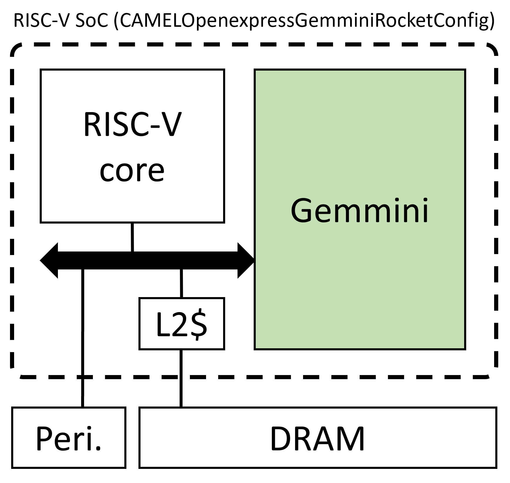
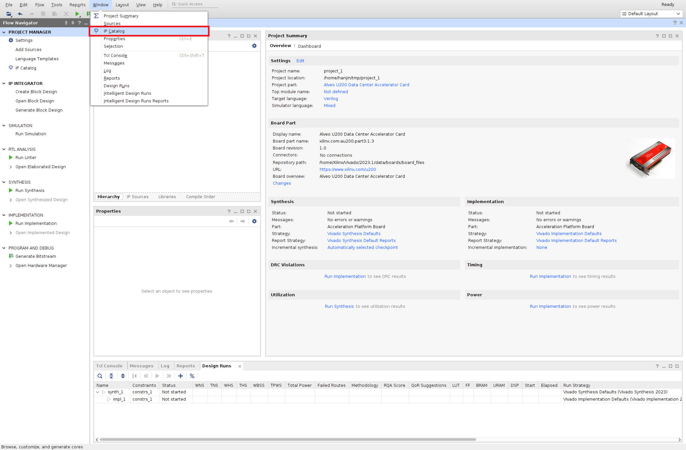
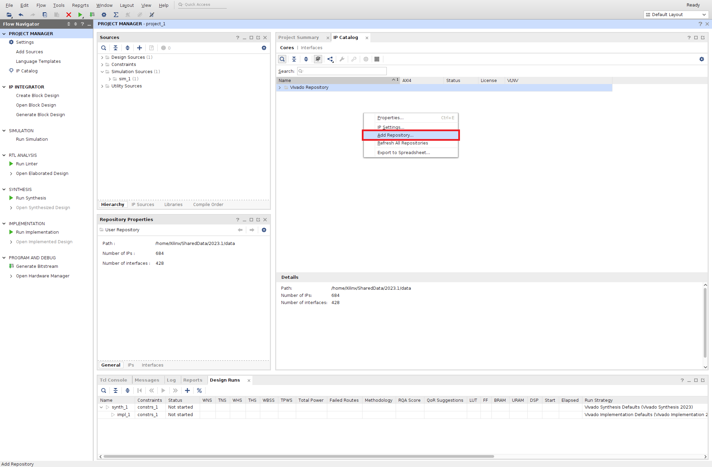
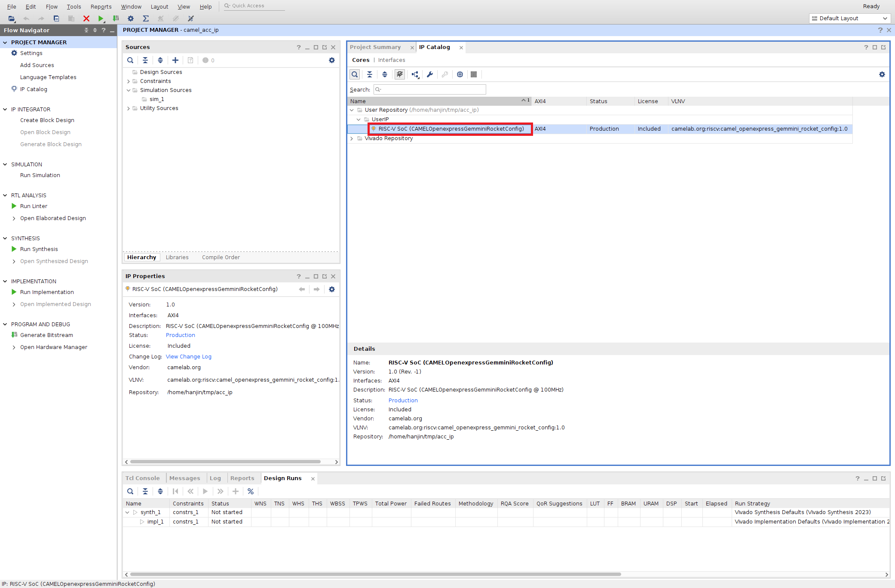
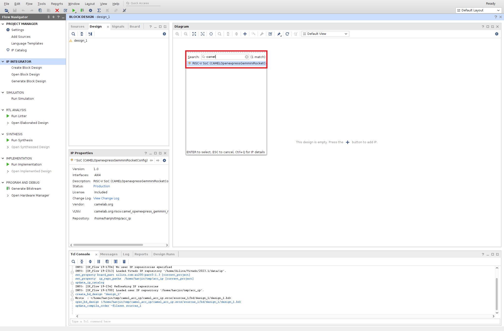
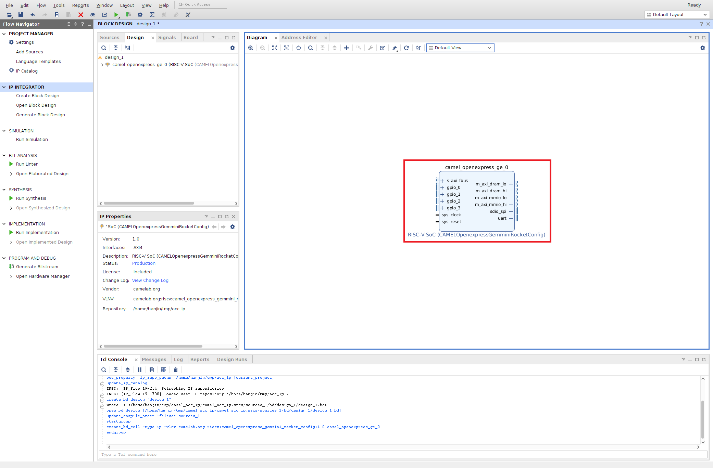

# CAMEL Accelerator IP

## IP Structure
This IP is composed of RISC-V CPU (Rocket), DNN accelerator (Gemmini). You have to connect DRAM controller and peripherals to run this IP.

  

## How-to
1. Create your vivado project
2. Open IP Catalog 

3. Add this Repository, then you can see CAMEL's hardware accelerator IP is added to your project.\
 

4. Open your block design and add CAMEL's IP 

5. Now you can use CAMEL's IP 

## Acknowledgment
This project is funded by IITP 2021-0-00524
